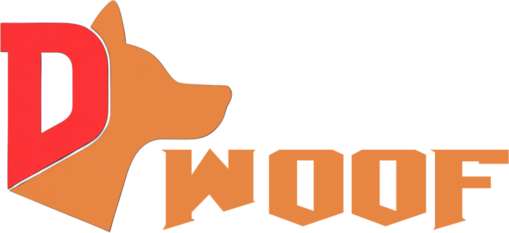

<p align="center">
  
</p>

<p align="center">
  
  
  
  
  
</p>

# Woof! for Android

An Android port of [Woof!](https://github.com/fabiangreffrath/woof), the Doom source port by Fabian Greffrath and contributors. It runs the unmodified Woof engine and adds a launcher and touch controls around it.

You need to provide your own game data (IWAD). None is included.

## Features

- Full Woof engine: Vanilla, Boom, MBF and MBF21 compatibility, widescreen, uncapped framerate, OPL music
- Launcher with IWAD and add-on (PWAD, PK3, DEH) selection and free-form command line arguments
- Import of WAD files through the system file picker
- Minimal touch controls with an in-app layout editor
- Touch mode for menus: a tap is a mouse click, Y/N buttons appear when the game asks a question
- Gamepad and keyboard work through SDL
- Multiplayer through SDL3_net

## Requirements

| | |
|---|---|
| Android | 5.0 (API 21) or newer |
| Game data | A Doom-engine IWAD, for example `doom.wad`, `doom2.wad`, `freedoom1.wad` |

Heretic, Hexen and Strife are not supported, because Woof itself does not support them.

## Game data

Put your IWAD and any add-ons into

```
Android/data/com.doom.woof/files/wads/
```

or use **Import** in the launcher, which copies files there. Files starting with `IWAD` show up under **Game**, everything else (PWAD, PK3, DEH, BEX) under **Add-ons**.

Extra command line arguments go into the launcher field, for example `-warp 1 -skill 4` or `-complevel 9`.

## Controls

| Control | Action |
|---|---|
| Left side of the screen | Floating joystick. Up and down move, left and right strafe. A partial push walks, a full push runs |
| Right side of the screen | Drag to turn |
| FIRE | Fire. Keep holding it and drag the same finger to aim |
| USE | Open doors, press switches |
| `<` `>` | Previous and next weapon |
| ESC, MAP | Menu, automap |
| Android Back | Escape |

In menus, title screens and intermissions the buttons are hidden and the screen behaves like a mouse. A second finger is a right click.

### Controls editor

**Launcher > Touch controls** opens the editor.

- Drag a button to move it, tap it to select it, then tap the hint at the top to hide or show it
- **Options**: button size, opacity, look sensitivity
- **Reset** restores the defaults

Settings are stored in `SharedPreferences` (`woof_controls`).

## Building

Requirements: Android Studio with SDK 36, NDK `29.0.14033849` and CMake `3.31.6`.

```
./gradlew assembleDebug
```

All native dependencies are vendored, so no network access is needed during the native build. The ABIs are set by `abiFilters` in `app/build.gradle`.

| Component | Version |
|---|---|
| Android Gradle Plugin | 8.13 |
| Gradle | 9.0 |
| compileSdk / targetSdk / minSdk | 36 / 34 / 21 |

## Project layout

```
app/src/main
├── assets/woof.pk3                 Woof resources (contents of base/), copied to internal storage on launch
├── cpp
│   ├── CMakeLists.txt              builds libmain.so: Woof + SDL3 + SDL3_net + OpenAL Soft
│   ├── woof_sources.cmake          Woof source list (from upstream src/CMakeLists.txt)
│   ├── android_glue.c              stdout/stderr to logcat, UI state for the touch overlay
│   ├── woof/                       Woof sources
│   └── third_party/                SDL 3.4.0, SDL3_net, OpenAL Soft 1.24.3
└── java
    ├── org/libsdl/app/             SDL 3.4.0 Java glue (SDLActivity and friends)
    └── com/doom/woof
        ├── MainActivity            launcher
        ├── GameActivity            SDLActivity subclass, runs in the :game process
        ├── TouchControlsView       on-screen controls and touch mode
        ├── ControlsEditorActivity  layout editor
        └── ControlsConfig          stored control settings
```

## How it works

- `GameActivity` extends `SDLActivity`. SDL loads `libSDL3.so` and `libmain.so` and calls `SDL_main`, which is Woof's `main`.
- The launcher passes `-iwad`, `-file` and extra arguments through `SDLActivity.getArguments()`.
- `woof.pk3` is copied to the app's internal files directory, which is where Woof looks for it on Android.
- The game runs in a separate process (`:game`). Woof quits with `exit()`, which must not take the launcher down.
- `TouchControlsView` sits on top of the SDL surface and feeds the game through `SDLActivity.onNativeKeyDown/Up` and `onNativeMouse`.
- It asks the engine about its state through one JNI call (`nativeUiState`): menu active, autorun on, Y/N question open. Two small hooks were added to Woof for this (`mn_menu.c`, `mn_container.c`, guarded by `__ANDROID__`).
- Audio goes through OpenAL Soft with the OpenSL ES backend.

## Limitations

- libsndfile, FluidSynth, libxmp and Discord RPC are not built. Music is played through Woof's built-in OPL emulation. Ogg, FLAC and Opus music, SoundFonts and tracker formats are not available.
- OpenAL Soft is LGPL and linked statically. Keep this in mind when distributing builds.

## Credits and licenses

- [Woof!](https://github.com/fabiangreffrath/woof): GPL-2.0
- [SDL](https://github.com/libsdl-org/SDL) and [SDL_net](https://github.com/libsdl-org/SDL_net): zlib
- [OpenAL Soft](https://github.com/kcat/openal-soft): LGPL-2.0

This is an unofficial port and is not affiliated with the Woof project. Doom is a trademark of id Software.
